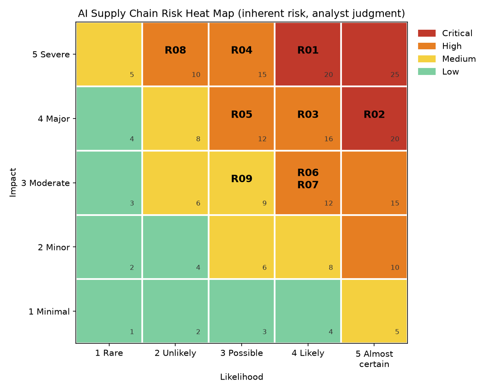

# Heat map

*Ratings are analyst judgment for an illustrative mid-size manufacturer/distributor, not measured data. Sources checked October 2026.*

| Impact (rows) vs. Likelihood (columns) | 1 Rare | 2 Unlikely | 3 Possible | 4 Likely | 5 Almost certain |
|---|---|---|---|---|---|
| **5 Severe** | 5 M | 10 H **R08** | 15 H **R04** | 20 C **R01** | 25 C |
| **4 Major** | 4 L | 8 M | 12 H **R05** | 16 H **R03** | 20 C **R02** |
| **3 Moderate** | 3 L | 6 M | 9 M **R09** | 12 H **R06, R07** | 15 H |
| **2 Minor** | 2 L | 4 L | 6 M | 8 M | 10 H |
| **1 Minimal** | 1 L | 2 L | 3 L | 4 L | 5 M |

Cell = score and band (C = Critical, H = High, M = Medium, L = Low); bold IDs are the assessed risks.

- **R01** AI-enabled supplier impersonation and payment fraud - 20 (Critical)
- **R02** Sensitive data leakage through generative AI tools (incl. shadow AI) - 20 (Critical)
- **R03** Third-party AI vendor dependency and concentration (fourth-party risk) - 16 (High)
- **R04** Prompt injection against AI agents that read supplier content - 15 (High)
- **R05** Regulatory, privacy and contractual non-compliance - 12 (High)
- **R06** Forecast model drift and over-automation in planning - 12 (High)
- **R07** Hallucinated, biased or unexplainable outputs in supplier selection - 12 (High)
- **R08** Poisoned or tampered models, data and AI packages - 10 (High)
- **R09** Intellectual property exposure through AI vendor terms - 9 (Medium)

---
[Back to project README](../README.md)
